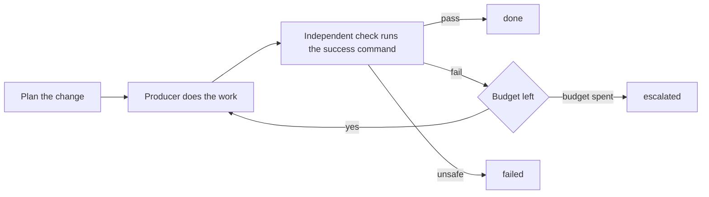

# Loop: <name>

Structure: <plain loop | graph>, because <one line: why the smaller structure is or is not enough>.

## Goal and input
<one sentence goal>. Input: <files, branch, ticket>. Success command: `<command>` exits 0.

## State
<what persists between iterations, where (files in git, not chat), and who may write it>

## Actions
Allowed: <...>. Not allowed without the owner: <merge, push to the default branch, anything irreversible>.

## Observation
<what feeds the next iteration: exit codes, test counts, review findings; agent reports are claims>

## Verification
<the command(s) and the expected result, run by someone other than the producer; who accepts>

## Stop and escalation
- done: <the success condition, proven by the verify node>
- failed: <what counts as an unrecoverable failure>
- escalated: <the decisions only the owner can make>, or a budget is spent

## Evidence
<SHAs, command outputs, versions that prove each terminal>

## Budget
Enforced by the controller, not requested of the agents:
- budget rework: 2

