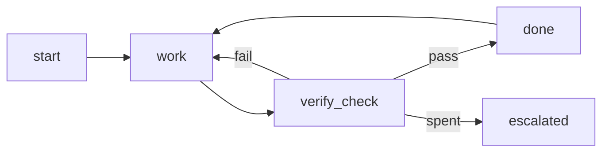

# Loop: minimal
Structure: plain loop, because one worker and one check are enough.
## Goal and input
a
## State
a
## Actions
a
## Observation
a
## Verification
a
## Stop and escalation
a
## Evidence
a
## Budget
- budget rework: 2

