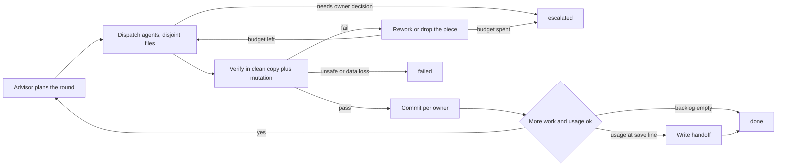

# Loop: one agent round (advise, fan out, verify, checkpoint)

Structure: graph, because the round has parallel branches, a join (verification) and a durable resume
point (the handoff file). A single agent loop would not make those visible.

## Goal and input
Land the next backlog items as verified, committed pieces. Input: the handoff file's Next list, the
branch HEAD, the owner's current usage figure. Output: new commits, an updated handoff. Success is
defined by the Verification section, never by an agent's report.

## State
Durable outside the context window, written only by the lead (the orchestrating session):
- git history on the working branch (the source of truth for what is done)
- the handoff file, for example `docs/handoff.md` (the resume point)
- `docs/memory/` (lessons and environment facts that outlive a round)
- the usage figure: owner-reported, kept in the conversation and in the handoff when saving

## Actions
Allowed: read the repo, spawn advisor and worker agents with disjoint file ownership, run tests and
builds in private copies, commit to the working branch. Not allowed without the owner: merge, push to
the default branch, publish releases, change the license, add secrets, spend past the usage lines.

## Observation
Agent reports (claims), exit codes and test counts from the lead's own runs, CI results, mutation-check
outcomes.

## Verification
A piece is accepted only when the lead has, in a clean copy made from `git archive HEAD` plus only that
agent's owned files, run the full test suite and the lint, and seen at least one deliberate mutation of
the new code fail a test. An agent's own report is an observation, not acceptance evidence.

## Stop and escalation
- done: backlog empty, or usage reached the save line and the handoff is written
- failed: verification shows data loss or an unsafe change that cannot be isolated
- escalated: a decision only the owner can make (license, scope, anything irreversible), or the
  rework budget is spent

## Evidence
Commit SHAs, test counts, lint output, mutation results, CI check runs. Never "the agent said it passed".

## Budget
Enforced by the lead, not requested of the agents:
- budget rework_per_piece: 2
- budget usage_wrap_up_percent: 95
- budget usage_save_percent: 98
- budget agent_minutes_per_round: 25

## Notes learned the hard way
- Build clean copies from `git archive HEAD` only. Copying the working tree pulls in other agents'
  unfinished files and produces false failures.
- One writer per shared file (indexes, wiring, the handoff): agents write their own files, the lead
  wires and merges.
- A hook that complains about uncommitted files fires while agents are mid-work. That is expected; do
  not commit unverified work to silence it.
